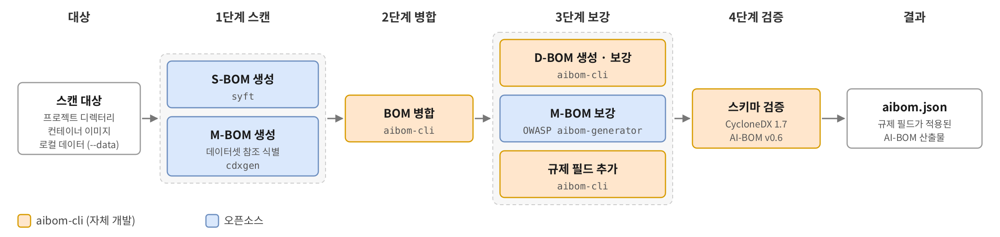

# 작동 방식

## 파이프라인

aibom-cli 는 검증된 오픈소스 도구가 찾은 패키지와 모델을 정리해 하나로 합치고, 도구가 채우지 못하는 모델·데이터셋 정보와 규제가 요구하는
값을 더해 AI-BOM 을 만든다. 어느 필드를 어느 도구가 채우는지는 [필드 탐색기](compliance/field-mapping.md)에서 본다.

## 단계별 세부 사항

- **S-BOM 생성 (syft)**: 패키지 매니페스트와 설치된 패키지에서 소프트웨어 컴포넌트를 찾는다.  
  `SYFT_COMPLIANCE_MISSING_VERSION=keep syft <target> --select-catalogers -ai -o cyclonedx-json@1.7`
    - `<target>`: 스캔 대상 (디렉터리, 컨테이너 이미지, 이미지 아카이브)
    - `SYFT_COMPLIANCE_MISSING_VERSION=keep`: 버전을 못 찾은 패키지는 `UNKNOWN` 대신 버전을 비워 둔다
    - `--select-catalogers -ai`: 모델 파일(gguf, safetensors) 카탈로거를 뺀다. 모델은 cdxgen 이 찾는다
    - `-o cyclonedx-json@1.7`: CycloneDX 1.7 JSON 으로 낸다
- **M-BOM 생성 (cdxgen)**: 코드의 모델 참조(`from_pretrained` 등), 로컬 모델(`config.json`, 모델 카드 README.md, gguf, Modelfile)에서 모델 컴포넌트를 만든다.  
  `cdxgen <target> -t ai --spec-version 1.7 --no-install-deps`
    - `<target>`: 스캔 대상. 이미지는 aibom-cli 가 푼 디렉터리를 넘긴다
    - `-t ai`: AI 관련 항목(모델, 데이터셋, AI 서비스)만 찾는다
    - `--spec-version 1.7`: CycloneDX 1.7 로 낸다
    - `--no-install-deps`: 의존성을 설치하지 않고 있는 파일만 읽는다. cdxgen 은 기본으로 일부 프로젝트의 의존성을 자동 설치한다
- **BOM 병합 (aibom-cli)**: 두 도구의 결과를 다듬어 AI-BOM 문서 하나로 합친다. 문서 정보(형식, 일련번호, 생성 시각)와 도구 목록을 하나로 통합하고, 두 도구가 각자 만든 루트를 스캔 대상을 나타내는 루트 컴포넌트 하나로 바꾸며, 모든 컴포넌트를 의존 관계로 그 루트에 잇는다.
- **D-BOM 생성 · 보강 (aibom-cli)**: 데이터셋 참조는 네 곳에서 온다. 로컬 모델의 모델 카드(학습·평가 데이터셋 모두 aibom-cli 가 직접 읽는다), 코드에서 참조하는 허브 모델의 모델 카드, gguf 헤더의 `general.datasets`, 코드의 `load_dataset` 호출과 데이터셋 링크다. 모두 [Hub API](https://huggingface.co/docs/hub/api) 와 [datasets-server](https://huggingface.co/docs/dataset-viewer) 에서 받아 채운다. 지정한 로컬 데이터는 파일을 직접 읽어 컴포넌트를 만든다.
- **M-BOM 보강 (aibom-cli, OWASP aibom-generator)**: 코드에서 참조하는 허브 모델의 빈 필드를 D-BOM 단계에서 받아 둔 Hub API 모델 응답으로 채운다 (버전, 라이선스, 설명, 공급자, 외부 참조(모델 주소, 논문), 계보, task, 구조, 입출력, 평가 결과, 파라미터 수, 컨텍스트 길이). OWASP aibom-generator 출력에서는 규제 필드 값(하이퍼파라미터, 컨텍스트 길이, 파라미터 수, 런타임)만 가져온다.  
  `python -m src.cli <owner/model>`
    - `<owner/model>`: cdxgen 이 찾은 허브 모델 id. 모델마다 한 번 부른다
- **규제 필드 추가 (aibom-cli)**: EU AI Act, ISO/IEC 42001, NIST AI RMF 가 요구하는 필드를 `--spec` 에 따라 properties 또는 AI-BOM v0.6 필드로 넣고, 채울 수 있는 필드 가운데 채운 수를 로그에 적는다. 두 방식은 [규제 준수](compliance/index.md)에 있다.
- **검증 (aibom-cli)**: 생성된 AI-BOM 을 CycloneDX 1.7 또는 AI-BOM v0.6 (CycloneDX) 스키마로 검증한다.
