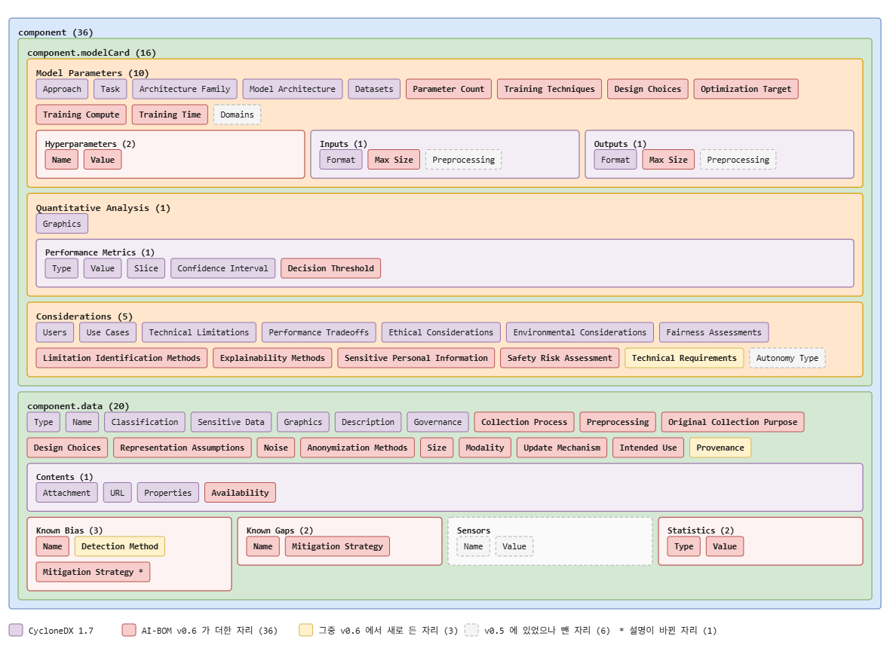
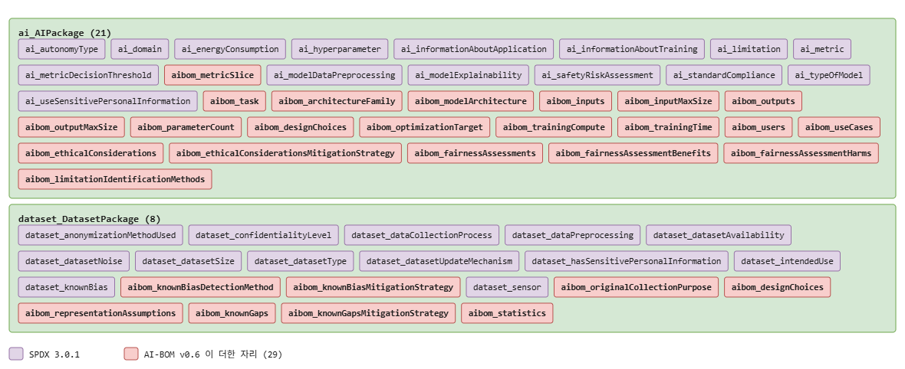

# AI-BOM v0.6 필드

`--spec v0.6` 으로 낼 때 쓰는 스키마다. AI-BOM v0.6 은 규제(EU AI Act, ISO/IEC 42001, NIST AI RMF)가 요구하지만 기존 표준에 담을 자리가
없는 값을 위해 CycloneDX 1.7 과 SPDX 3.0.1 에 각각 필드를 더한 스키마 2종이다. 기존 필드의 이름, 타입, 필수 여부는 바꾸지 않고
새 필드를 기존 객체 안에 더하며, 더한 필드는 전부 선택 필드다. aibom-cli 는 이 중 CycloneDX 1.7 기반으로 내고 검증한다.

| | CycloneDX 1.7 기반 | SPDX 3.0.1 기반 |
|---|---|---|
| 더한 필드 | 36개 | 29개 |
| 모델 | `component.modelCard` | `ai_AIPackage` |
| 데이터셋 | `component.data` | `dataset_DatasetPackage` |

## 구조

CycloneDX 1.7 기반

SPDX 3.0.1 기반

## 지원 현황

v0.6 이 정의한 필드 가운데 aibom-cli 가 스캔 결과로 값을 채우는 것은 열한 개다. 나머지 필드는 순차적으로 지원할 예정이다.

| 대상 | 필드 | 값의 출처 |
|---|---|---|
| 모델 | hyperparameters, parameterCount | 로컬 모델은 `config.json`, gguf·safetensors 헤더 (aibom-cli), 허브 모델은 OWASP aibom-generator 가 Hub 에서 읽은 같은 값 |
| 모델 | inputs maxSize, technicalRequirements | cdxgen 이 읽은 gguf·Modelfile 과 코드의 import, 허브 모델은 OWASP aibom-generator |
| 데이터셋 | size, modality, availability, provenance, statistics | Hub API 와 datasets-server (허브 데이터셋), 파일 분석 (로컬 데이터) |
| 데이터셋 | intendedUse, collectionProcess | 허브 데이터셋 카드의 `task_categories`·`task_ids`, `annotations_creators`·`language_creators` (허브 데이터셋만) |

규제 필드는 아니지만 허브 모델의 평가 결과(모델 카드 `model-index`)도 OWASP aibom-generator 를 거쳐 CycloneDX 의
`modelCard.quantitativeAnalysis.performanceMetrics` 로 들어온다.

각 필드가 어디에 붙는지, 기존 표준의 어느 필드와 대응하는지, 어느 규제 조항에 근거하는지는 [필드 탐색기](field-mapping.md)에서 볼 수 있다.
